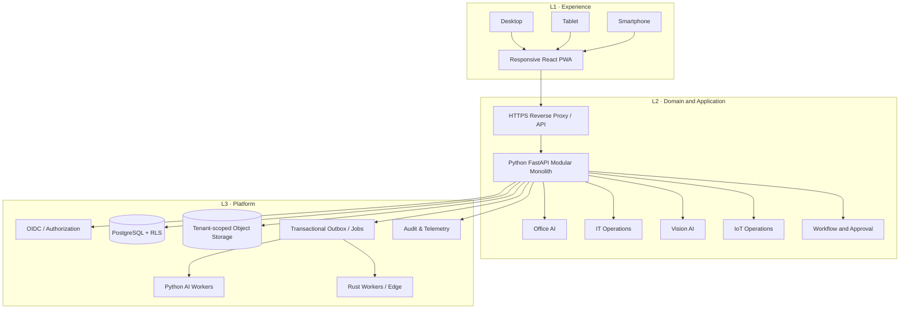

# Architecture Overview — C4-style Context and Containers

## Context
The customer owns a tenant with one or more sites, departments, users and registered devices. The platform operator manages subscriptions, upgrades and service health, but does not automatically access customer business data.

## L1 — Business & Experience
- Desktop: dense workbench, accessible navigation, data tables, bulk actions and audit drill-down.
- Tablet: field checklist, status cards, camera/photo capture (browser permissions), landscape/portrait support.
- Smartphone: notifications, approvals, search, quick actions, on-site scanning.
- Tenant switch is explicit and clearly visible; theme, locale and permitted modules follow tenant context.

## L2 — Domain Services
Domain contracts: tenant-scoped commands, queries, domain events and adapters. No inter-domain direct table reads.
- Office AI: document ingestion, OCR, validation, approvals, export integration.
- IT Ops: inventory, checks, incidents, support workflows.
- Vision AI: cameras, inference configuration, review and evidence.
- IoT Ops: devices, gateways, telemetry, rules and alerts.
Shared: approvals, notifications, scheduler, job queue, AI provider policy.

## L3 — Platform & Infrastructure
OIDC identity, Postgres/RLS, object storage, transactional outbox, background workers, optional Redis/Valkey, observability, backup and recovery.

## Deployment profiles
- **Shared SaaS:** shared compute/DB cluster, enforced logical isolation, per-tenant object namespaces and credentials, no guaranteed physical isolation.
- **Dedicated:** per-tenant DB and storage credentials/instance, separate environment where requested.
- **Hybrid:** edge processing stays on site; only explicitly allowed events/media leave the site, with retry and offline buffering.

## Architecture quality gates
Reliability, confidentiality, auditability, ease of use, upgradeability and low cost must be measured, not assumed.
